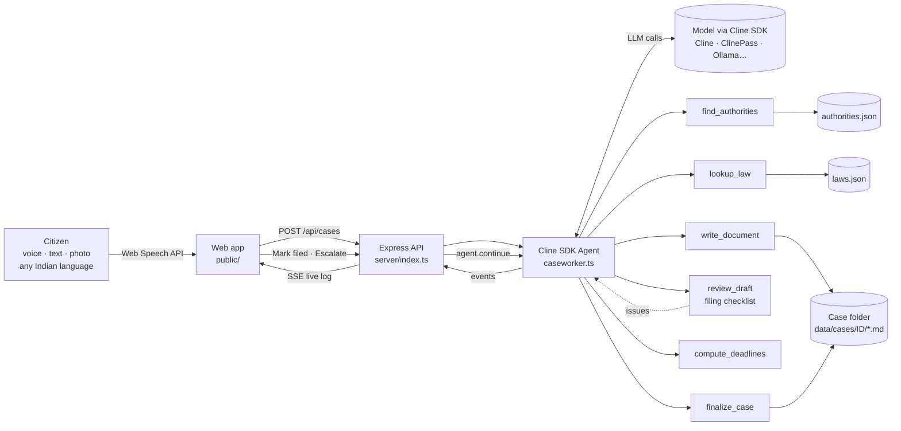

# हक़ Haq — an AI caseworker for every Indian citizen

> Tell Haq your problem in your own language. It finds the office responsible, checks the law, writes a complaint and an RTI application that won't get rejected, tracks the legal deadlines, and drafts your appeal when the government doesn't reply.
>
> **Haq's caseworker is a Cline SDK agent.** It handles each case the way Cline handles a repo: it plans, uses tools, writes files into a case folder, checks its own work and fixes it.

Built for the **Cline AI Builder Hackathon, IIT Guwahati (10 Oct 2026)**.

---

## The problem

India has the laws to fix everyday problems, but people can't use them:

- A pothole sits outside a house for weeks. The family doesn't know whether it's the **municipal corporation, PWD or NHAI** that should fix it.
- A widow's pension stops. She goes to the block office twice and gets no answer. She has never heard of the **RTI Act**, or of the rule that the office must reply **within 30 days**.
- Someone loses ₹18,000 to a UPI scam. They don't know that reporting within **3 working days** can mean **zero liability** under RBI rules, or that **1930** can freeze the money.

The Right to Information Act, consumer law, electricity consumer rules, the RBI Ombudsman and Right-to-Services Acts all give citizens real power. But using that power means knowing **which office to approach, what to write, what the deadlines are and how to escalate**. That knowledge sits with lawyers, activists and a handful of RTI veterans. Everyone else gives up.

## The solution

Haq is a voice-first web app that works like a free, tireless caseworker:

1. **Tell it.** Speak or type in Hindi, Hinglish, Assamese, Bengali, Tamil and other languages. You can attach a photo of the pothole, the notice or the bill.
2. **Watch it work.** A live log shows the agent's Plan → Act → Verify loop: finding the authority, looking up the law, drafting the papers, running the filing checklist and fixing anything it flags.
3. **Get a case file** with:
   - a **plain-language summary in your language** that you can play aloud for low-literacy users,
   - the **responsible authority**, with the real portal, helpline and escalation ladder,
   - a **formal complaint** and an **RTI application under Sec. 6(1)**, with blanks for your details and a fill-in editor, print-to-PDF and WhatsApp sharing,
   - **statutory deadlines** worked out by code, not guessed by the LLM.
4. **Mark as filed.** Haq counts the days. When the 30-day RTI deadline passes, one tap tells the caseworker to draft the **First Appeal under Sec. 19(1)**, check it, and update your next steps and deadlines.

### What makes it different
| | Typical "AI legal chatbot" | Haq |
|---|---|---|
| Authority & helplines | Hallucinated from model memory | Grounded tool calls to a curated directory (city → state → national) |
| Drafts | Free text, often rejected (e.g. "why" questions in an RTI, over the word limit) | A deterministic **filing checklist** that the agent must pass. It rewrites the draft until it does |
| Deadlines | "Usually about a month" | Exact dates from the statute's rules (RTI 30 days → first appeal +30 → second appeal +90) |
| After the chat | Nothing | A persistent case with countdowns and one-tap escalation |
| Language | English | The citizen's language for everything they read, English for the official papers |

## Cline inside the product

Every case is a Cline SDK `Agent` session (`server/agent/caseworker.ts`):

```ts
import { Agent } from "@cline/sdk";

const agent = new Agent({
  providerId: "cline",                  // or cline-pass, anthropic, gemini, ollama …
  modelId: "anthropic/claude-sonnet-5",
  apiKey: process.env.CLINE_API_KEY,
  systemPrompt: systemPrompt(),         // caseworker playbook: plan → act → verify
  tools: buildCaseTools(caseId),        // custom tools bound to this case folder
  toolExecution: "sequential",
  maxIterations: 24,
});
agent.subscribe(streamToCaseTrace);     // tool-started / tool-finished / text deltas → live UI over SSE
await agent.run(intakeMessageWithOptionalPhoto);
// later: await agent.continue("The RTI got no reply in 30 days — escalate.")
```

**Custom tools** (built with `createTool` and zod schemas, in `server/agent/tools.ts`):

| Tool | What it does |
|---|---|
| `find_authorities` | Ranks 20+ grievance bodies (municipal corporations, PWD, NHAI, DISCOMs, CPGRAMS, RBI Ombudsman, cyber crime 1930, consumer commissions, PDS, PM-JAY, local Assam bodies such as GMC, APDCL and RTPS) by category and location |
| `lookup_law` | Returns citable provisions (RTI Act, RTI Rules 2012, Consumer Protection Act, Electricity Consumer Rules 2020, RBI Ombudsman Scheme, NFSA, MGNREGA, RTE, MV Act 198A…) |
| `write_document` | Writes the complaint, RTI or appeal as Markdown files in the case folder |
| `review_draft` | Runs the filing checklist: Sec. 6(1) cited, fee/BPL mentioned, numbered requests, **no "why" questions**, **≤500 words**, addressee, location, dates, relief, enclosures |
| `compute_deadlines` | Statutory date arithmetic (RTI, first appeal, CPGRAMS 21 days, bank 30 days, consumer 2 years…) |
| `read_case_file` | Gives the agent memory of the case for follow-ups and escalation |
| `finalize_case` | Publishes the structured summary, steps and checklist (in the citizen's language) to the dashboard |

This uses the harness the way the Cline team describes it: **the right tools at the right time, failure detection and self-correction** (the review → rewrite loop), and **a model you can swap**. The same app runs on Cline usage billing, ClinePass open-weight models, or fully local with Ollama for privacy.

**Offline demo model:** if no API key is set, Haq swaps in a scripted `AgentModel` (`server/agent/demoModel.ts`). Everything else is still real: the Cline agent loop, the tools, the knowledge base, the reviewer and the case folder. The UI labels these runs *"Offline demo model"*. It's a safety net for stage demos with bad Wi-Fi.

## Architecture



```
haq/
├── server/
│   ├── index.ts              # REST + SSE API
│   ├── config.ts             # provider/model selection (live vs offline demo)
│   ├── deadlines.ts          # statutory date rules
│   ├── agent/
│   │   ├── caseworker.ts     # Cline SDK Agent lifecycle, event → trace streaming, continue()
│   │   ├── tools.ts          # 7 custom tools (createTool + zod)
│   │   ├── review.ts         # deterministic filing checklist
│   │   ├── prompt.ts         # caseworker playbook
│   │   └── demoModel.ts      # scripted AgentModel for offline demos
│   ├── cases/store.ts        # file-based case folders + event bus
│   └── kb/                   # authorities.json, laws.json (+ search)
├── public/                   # index.html, styles.css, app.js (no build step)
├── scripts/smoke.ts          # end-to-end test through the agent loop
├── .clinerules/              # rules Cline follows when working on this repo
└── docs/                     # demo script, Cline build prompts, social post
```

## Tech stack
- **Agent:** `@cline/sdk` 0.0.92 (`Agent`, `createTool`, streaming runtime events)
- **Models:** any Cline SDK provider. Default `cline` → `anthropic/claude-sonnet-5`. Also works with ClinePass open-weight models (GLM, Qwen, DeepSeek, Kimi…) and local Ollama
- **Backend:** Node 22, TypeScript (tsx), Express, zod v4, server-sent events, file-based case storage
- **Frontend:** vanilla HTML/CSS/JS, Web Speech API (speech-to-text in Indian languages), SpeechSynthesis (read-aloud), on-device photo downscaling, print-to-PDF stylesheet, WhatsApp share
- **Type:** Mukta (Ek Type, Devanagari + Latin) for the UI, Courier Prime for "typed" official drafts

## Setup

```bash
git clone <this repo> haq && cd haq
npm install
cp .env.example .env        # optional: add CLINE_API_KEY for live AI
npm start                   # → http://localhost:3000
npm test                    # optional: end-to-end smoke test
```

- **No key?** It runs on the offline demo model straight away.
- **Live AI:** set `CLINE_API_KEY` (from your Cline account) in `.env`. You can change the model with `HAQ_PROVIDER` / `HAQ_MODEL`, e.g. `cline-pass` + `cline-pass/glm-5.3`.
- **Voice input** works in Chrome/Edge (desktop and Android). Use `localhost` or HTTPS so the browser allows the microphone.

## How Cline was used

### Inside the product
See [Cline inside the product](#cline-inside-the-product). The caseworker *is* a Cline SDK agent with seven custom tools, a self-review loop and multi-turn escalation through `agent.continue()`.

### In the build
<!-- ✍️ Fill this in truthfully from your own Cline sessions before submitting. Keep screenshots/recordings. -->
- Cline (VS Code extension, Plan → Act mode, model: _____) was our coding partner throughout. Project conventions live in [`.clinerules/`](.clinerules) so every Cline session follows the same rules (no LLM date math, every document type needs reviewer checks, never invent helplines).
- Features built with Cline during the hackathon: _see [docs/CLINE_BUILD_PROMPTS.md](docs/CLINE_BUILD_PROMPTS.md) and list the ones you shipped here, with commit links._
- Cline ran `npm run check` and `npm test` after each change to verify its own work.

## Challenges
- **Hallucinated authorities are dangerous.** A wrong helpline wastes a poor person's day. We moved every fact the model might invent (offices, portals, helplines, laws, deadlines) into tools backed by curated data and code.
- **"Valid" isn't the same as "accepted".** RTI applications get rejected for asking "why", for going over the word limit, or for being sent to the wrong addressee. We encoded these failure modes in a reviewer the agent must pass, the same detect-and-fix loop Cline uses for failing tests.
- **Language vs. legal register.** Citizens think in Hindi or Assamese, but offices expect formal English. Haq writes the summary in the citizen's language and the official papers in English, with highlighted blanks for personal details.
- **Demos on hackathon Wi-Fi.** We wrote an offline `AgentModel` so the real agent loop and tools still run without network access.

## Future scope
- **WhatsApp and IVR channels**, so people without smartphones can call, speak and receive a PDF.
- **Direct filing integrations** (CPGRAMS, state CM portals, rtionline.gov.in) and automatic status checks.
- **Community map** of anonymised cases, so a ward with 40 pothole complaints becomes a ward-level escalation (and a dashcam feed could open these cases automatically).
- **State packs**: per-state RTI fee rules, word limits and Right-to-Services timelines; more NE-state authorities.
- **Agent teams**: a "senior caseworker" subagent that reviews high-stakes cases (evictions, medical refusals) and routes them to free legal aid (NALSA 15100).

## Disclaimer
Haq prepares drafts and points to official channels. It is not a lawyer and does not file on your behalf. Verify portal links and helplines before filing. For court matters, contact your District Legal Services Authority (free legal aid, 15100).

## License
MIT
